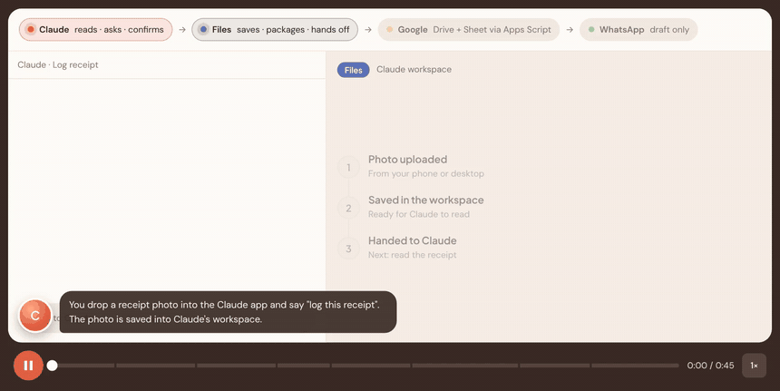
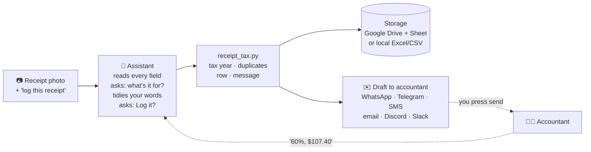

# receipt-tax

**Snap a receipt and your AI assistant does the rest.** It reads the receipt, asks one question
about what the purchase was for, files the photo in the right tax-year folder, adds a row to your
spreadsheet and drafts a message to your accountant asking how much you can claim back.

Works from the **Claude app** (phone, web, desktop), **Claude Code**, **OpenAI Codex** and
**ChatGPT**. Store receipts in **Google Drive + Sheets** or a local **Excel/CSV** file. Message
your accountant on **WhatsApp, Telegram, SMS/iMessage, email, Discord or Slack**.

[](docs/media/walkthrough.mp4)

<sub>▶ [Full walkthrough video (45 s, mp4)](docs/media/walkthrough.mp4). The demo uses made-up data.</sub>

---

## What happens when you send a receipt



1. **Read.** The assistant copies every field exactly as printed: date, supplier, tax/business
   number, line items, tax, total, payment method and receipt number. Anything it can't read
   becomes empty, never a guess. It also checks the line items add up.
2. **Ask.** One question: *"Roughly, what's this for?"* Your answer is cleaned up for spelling
   and grammar **only**. No new facts, no opinions, no "this is deductible". Anything you said
   about private use stays in.
3. **Confirm.** You see everything once and say yes.
4. **Store.**
   - The photo is renamed `2026-11-14_Northside-Tech-Supplies_179.00_Tax26-27-0001.jpg` and filed
     in `Taxes/Tax26-27/`.
   - A row goes into `Tax26-27 receipts`, which has a Receipts tab and a Summary tab with totals.
   - Duplicates are caught, whether it's the same photo or the same supplier, date and total.
5. **Draft.**
   ```
   Hi Priya,

   I've bought the following. Here are the details from the receipt:

   • Item: Logitech MX Keys keyboard
   • Purpose: I use it mostly for university and my tutoring work, and sometimes for gaming.
   • Supplier: Northside Tech Supplies (ABN 12 345 678 901)
   • Date: 14/11/2026
   • Total: $179.00 (incl. $16.27 GST)

   How much of this can I claim back?
   ```
   Link channels such as WhatsApp open with this text filled in. **Nothing is sent until you
   press send.**
6. **Close the loop.** When your accountant replies, tell the assistant ("they said 60%,
   $107.40"). It writes that onto the same row, so by tax time the spreadsheet is your summary.

The tax year rolls over by itself. A receipt dated 1 July 2027 goes to `Tax27-28/` (or whatever
your country's year is, see [regions](docs/regions.md)).

---

## Pick your setup

Make three choices, then follow the linked guide.

### 1. Where you'll use it

| You want to... | Use | Guide |
|---|---|---|
| Snap receipts on your phone, anywhere | **Claude app** (iOS/Android/web) | [clients.md#claude-app](docs/clients.md#claude-app) |
| Run it on your computer | **Claude Code** or **Codex** | [clients.md#claude-code](docs/clients.md#claude-code) · [#codex](docs/clients.md#codex) |
| Use ChatGPT | a **Custom GPT** with an Action | [clients.md#chatgpt](docs/clients.md#chatgpt) |

### 2. Where receipts are stored

| Storage | Works from | Spreadsheet | Setup |
|---|---|---|---|
| **Google Drive + Sheets** (recommended) | everywhere: phone, web, PC, ChatGPT | Google Sheet (downloads as .xlsx) | ~10 min, [storage-google.md](docs/storage-google.md) |
| **Local Excel / CSV** | only on your own computer (Claude Code, Codex) | `.xlsx` with formulas, or `.csv` | ~1 min, [storage-local.md](docs/storage-local.md) |
| **Your own backend** (OneDrive, Notion, Airtable, Dropbox...) | depends | yours | [storage-custom.md](docs/storage-custom.md) |

> **Why not "just save it in the Claude app"?** The Claude app runs skills in a temporary cloud
> sandbox. Anything saved there is gone after the chat ends, and it can't sign in to your
> Google account. A small backend in **your** account (the Apps Script) is what makes the
> spreadsheet permanent.

### 3. How your accountant hears about it

| Channel | How it works | Sends automatically? |
|---|---|---|
| **WhatsApp** | `wa.me` link opens a chat with the text filled in | No, you tap send |
| **Telegram** | `t.me/share` link, you pick the chat | No |
| **SMS / iMessage** | `sms:` link opens Messages (phones) | No |
| **Email** | `mailto:` link opens a draft | No |
| **Discord** | channel webhook posts the message | **Yes**, after you confirm |
| **Slack** | incoming webhook posts the message | **Yes**, after you confirm |
| **Copy** | plain text to paste anywhere (Signal, Teams, a portal...) | No |

You can list several at once. Details, setup and gotchas: [messaging.md](docs/messaging.md).

---

## Quick start (Google storage + Claude app + WhatsApp)

```bash
git clone https://github.com/ChinmayGit8765/receipt-tax && cd receipt-tax
```

1. **Backend.** Follow [storage-google.md](docs/storage-google.md): paste
   `backends/google-apps-script/` into script.google.com, run `setup` once, deploy as a web app.
   You get a URL ending in `/exec` and the token you chose.
2. **Config.** Copy `skill/receipt-tax/config.example.json` to `skill/receipt-tax/config.json` and
   fill in the URL, token, your accountant's name and WhatsApp number.
3. **Package.** Run `python scripts/build_skill_zip.py`. It creates `dist/receipt-tax-skill.zip`.
4. **Upload.** In claude.ai, go to Settings → Skills and upload the zip. Check that code
   execution is on and that `script.google.com` and `script.googleusercontent.com` are allowed
   (see [clients.md](docs/clients.md#claude-app)).
5. **Test.** In a new chat, type *"use receipt-tax to ping the backend"*. Then send a receipt.

---

## What's in this repo

```
skill/receipt-tax/              the skill (Claude, Codex and any SKILL.md-compatible agent)
  SKILL.md                      what the assistant does: read, ask, clean, confirm, store, report
  scripts/receipt_tax.py        the exact work: tax year, storage, duplicates, message drafts
  config.example.json           copy to config.json (git-ignored)
backends/google-apps-script/    the Google backend: Code.gs, Config.example.gs, appsscript.json
chatgpt/                        Custom GPT instructions + Action schema
docs/                           setup guides per client, storage, channel and region
scripts/build_skill_zip.py      packages the skill (with your config) for upload
tests/                          python -m unittest discover tests · node tests/apps-script.test.js
```

## Privacy and safety

- **Your data stays in your accounts.** The Google backend runs as you, in your Drive. Nothing
  passes through a third-party server. The AI provider you use sees the receipt photo, as with
  any chat.
- **The token is the key.** Anyone holding your `/exec` URL **and** token can add rows. Keep
  `config.json`, `Config.gs` and the built zip private. To revoke access, change the token and
  redeploy. More in [privacy.md](docs/privacy.md).
- **Not tax advice.** The assistant is told never to say whether something is deductible.
  That's your accountant's job, and the whole point of the message.

## Tests

```bash
python -m unittest discover tests     # tax years, local xlsx/csv, every channel, fake Google + Discord
node tests/apps-script.test.js        # the Apps Script backend against fake Google services
```

## License

[MIT](LICENSE)
